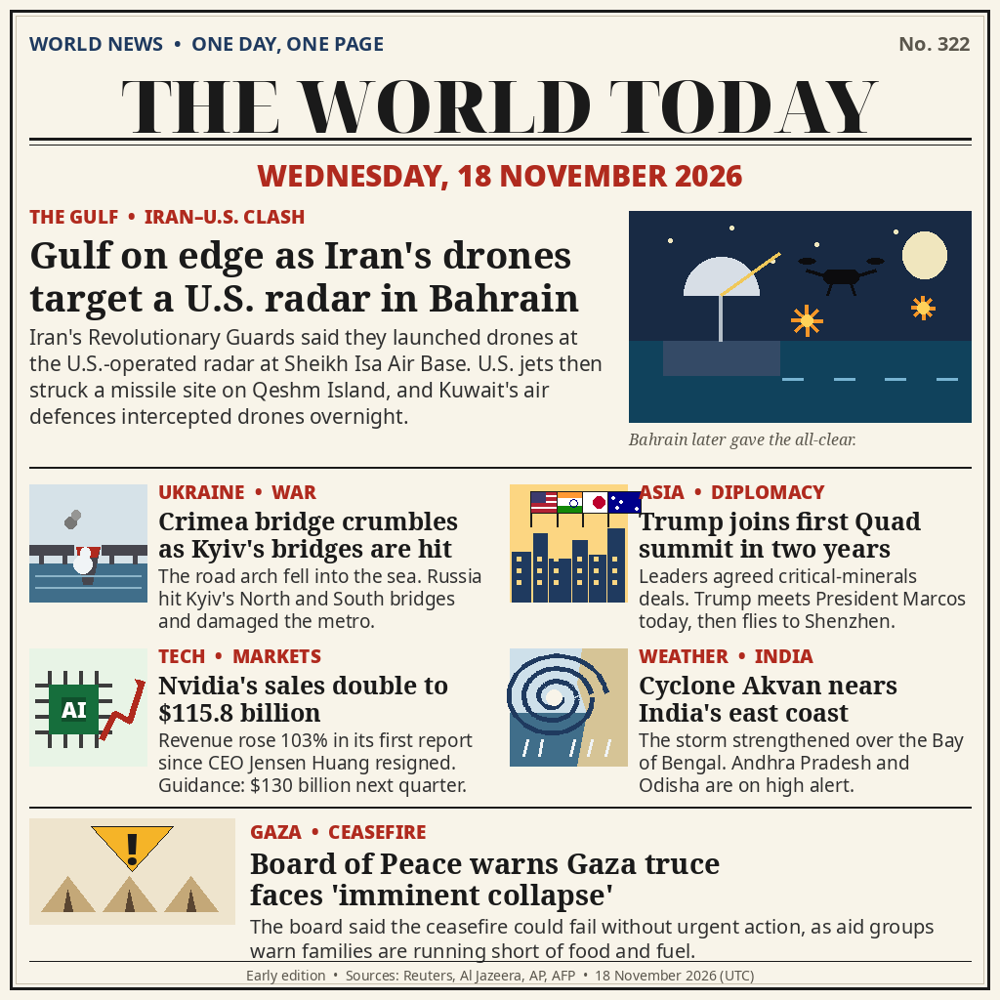

[](https://make.fun/bounty/news-image-20261118)
[](https://make.fun/bounty/news-image-20261118)
[](https://make.fun/bounty/news-image-20261118)

# The World Today — Wednesday, 18 November 2026

One image that sums up Wednesday 18 November 2026's world news, as a
newspaper front page. Built for the [make.fun bounty](https://make.fun/bounty/news-image-20261118)
"Sum up 18 November's world news in one image" ($250 pot, top 50 share prizes).



## The day's six stories

1. **The Gulf — Iran–U.S. clash (lead).** Iran's Revolutionary Guards
   launched drones at the U.S.-operated radar at Sheikh Isa Air Base in
   Bahrain; U.S. jets then struck a missile site on Qeshm Island, and
   Kuwait's air defences intercepted drones overnight. Bahrain later gave
   the all-clear.
2. **Ukraine — war.** Ukraine struck the Kerch (Crimean) bridge for a
   second day; its road arch collapsed into the sea. Russia hit Kyiv's
   North and South bridges and damaged the metro.
3. **Asia — diplomacy.** Donald Trump joined the first Quad summit in two
   years in Manila, with the leaders of India, Japan and Australia, and
   critical-minerals deals were agreed. He meets President Marcos, then
   flies to Shenzhen.
4. **Tech — markets.** Nvidia's revenue doubled to $115.8 billion (+103%)
   in its first report since CEO Jensen Huang resigned; guidance is $130
   billion next quarter.
5. **Weather — India.** Cyclone Akvan strengthened over the Bay of Bengal;
   Andhra Pradesh and Odisha are on high alert.
6. **Gaza — ceasefire.** The Board of Peace warned the Gaza truce faces
   "imminent collapse" without urgent action, as aid groups warn families
   are running short of food and fuel.

Sources: Reuters, Al Jazeera, AP, AFP. Early edition — built from the news
available in the first hours of 18 November 2026 (UTC), before the day had
fully unfolded.

## How it works

- `tools/render_poster.py` draws the 1024×1024 poster with Pillow
  (deterministic: no network, no randomness, no timestamps) and writes
  `assets/poster.png`.
- `main.py` (Python 3.13, standard library only) copies
  `assets/poster.png` to `/output/entry.png` — the simplest entry the
  competition rules explicitly allow.

Run it locally:

```sh
python3 tools/render_poster.py   # re-render assets/poster.png
mkdir -p out && MAKEFUN_OUTPUT_DIR=out python3 main.py
```

## License

MIT — see [LICENSE](LICENSE).
